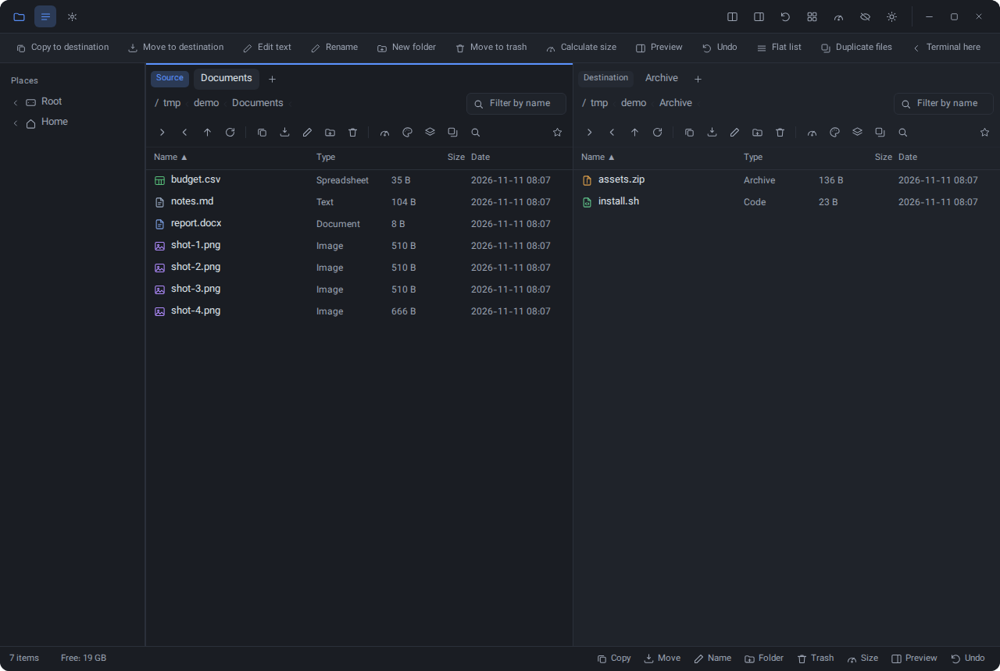
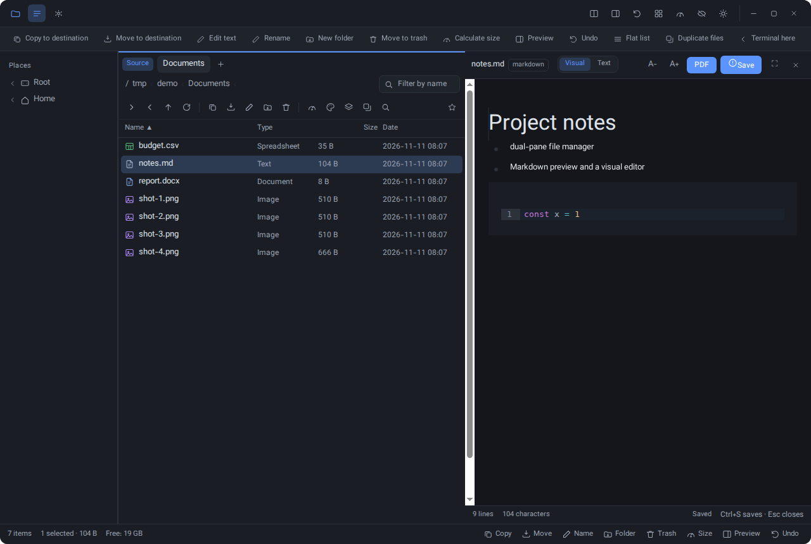
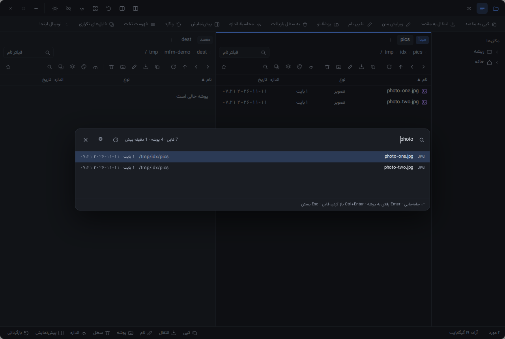
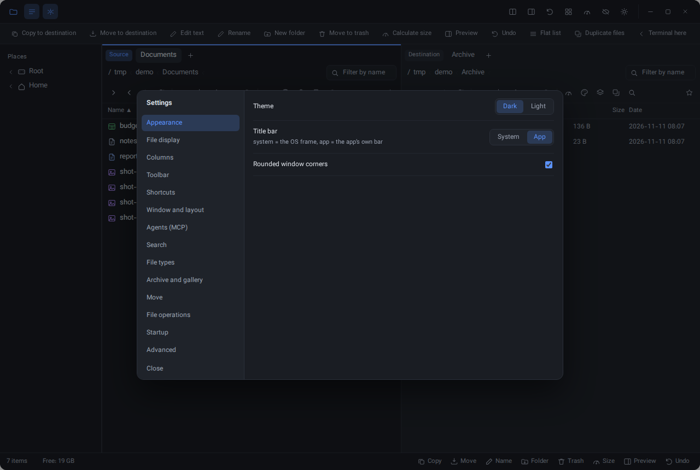
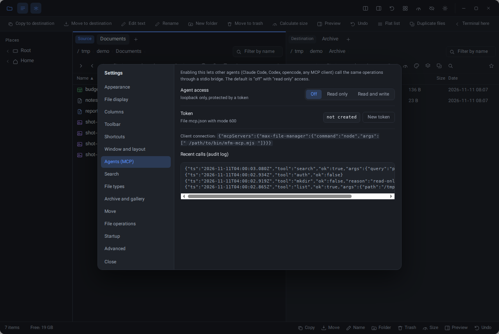

# Max File Manager

A dual-pane desktop file manager for KDE and Windows, aiming at Directory Opus level of features — built with Electron, TypeScript and React. **English by default**, Persian (RTL) one click away in Preferences → Appearance; paths and file names always keep their own direction. The complete **Pure** icon set is bundled inside the app, so files and folders look the same on every OS.



## At a glance

| | |
|---|---|
| **Two panes, real tabs** | pinned tabs, drag to reorder, rename, lock (navigation opens a fresh tab), per-tab colour and folder icon, a tab menu, `Ctrl+T/W/Tab`, per-pane back/forward history |
| **Single pane when you want it** | the copy/move target stays tracked and is shown in the status bar |
| **Language and colour themes** | English/Persian switches live (RTL/LTR); ten colour palettes on top of light/dark |
| **Icons that travel** | 3,044 Pure 64 px icons bundled in the app, OS icon theme optional, per-folder colour/icon and a category/size icon picker |
| **One command registry** | every action is a command (`commands.ts`); the toolbar, the shortcut editor and the status bar all read the same list, and every key is rebindable |
| **Transfers never block the UI** | a queue with byte progress, speed, pause/resume, cancel, per-item errors, and undo |
| **Nothing is overwritten** | existing names become `name (2).ext`; delete goes to the OS trash unless you hold `Shift` |

Grid view with real thumbnails (256px cache, served over `thumb://`):


## Previews and editors

The preview opens in the opposite pane (`F3`) or as a side panel; a rendered Markdown preview with line numbers for text, an image, audio, video, PDF through Chromium's own viewer, Office text by reading `docx/xlsx/pptx` zip+XML, and HTML in a sandboxed frame with scripts stripped:


`F4` is a real editor: the visual Markdown surface (Milkdown/Crepe — slash menu, tables, task lists, CodeMirror blocks, per-block direction, code always LTR) or the highlighted source view with line numbers, wrapping and an atomic `Ctrl+S`:



## Finding things

An indexed search builds a database of the folders you choose (with exclusions), keeps it current incrementally, and jumps to the containing folder with the file selected — keyboard first, Persian queries included:



## Settings

One typed preferences object, persisted atomically in SQLite (`search.db`, table `app`) together with the window state, with pages for appearance, file display, columns, toolbar, shortcuts (with conflict detection), window and layout, transfers, file operations, startup, file types, default applications per extension, archive and gallery, search, agents and advanced. The roadmap behind it is derived from the Directory Opus, Krusader and FreeCommander manuals: [docs/PREFERENCES.md](docs/PREFERENCES.md).



## Agents (MCP) — off by default

A loopback-only HTTP API with a bearer token (`~/.config/max-file-manager/mcp.json`, mode `600`) exposes 91 tools over the *same* operations the UI uses — files, transfers, the index, tags, colours, ratings, apps and the window itself, plus a dependency-free stdio bridge (`bin/mfm-mcp.mjs`) and an append-only audit log that records the tool and the shape of its arguments — never file contents.



Modes: `off` (default), `read` or `write`. Design notes: [docs/MCP.md](docs/MCP.md).

## What works today

- **Single or dual pane**, full tabs in each, session restore (panes, tabs, sort, bookmarks, every preference)
- **Single instance**: launching again raises the open window and opens the path you handed it; optional **minimize to tray / close to tray** with a show/quit tray menu
- **Startup choice**: restore the previous session or always open one fixed folder
- **Configurable columns**: type, size, date (ISO or Jalali), permissions, owner, hard links, image dimensions — all sortable (asc/desc), and every folder remembers its own sort in `.mfm.json`; folders stay grouped first for name and size sorts
- **Inline address bar**: `Ctrl+L` or a double-click on the breadcrumb edits the path in place; the field stays LTR in Persian, and the row itself is LTR
- **Type-to-filter**: start typing over the list and the live name filter opens with your first character
- **Status bar details**: a single selection shows name, type, size, date, permissions, colour label and rating
- **Configurable command toolbar** — add, remove, reorder; an empty bar hides it
- **Folder sync** (`Ctrl+Shift+Y`) comparing by modification time, creation time or content hash, with ignore patterns, differences-only view and trash-safe deletes; **file diff** (`Ctrl+Shift+Z`) for two selected files
- **Indexed search** (SQLite FTS5) over your chosen folders, exclusions, incremental re-index, and instant folder sizes from the same index
- **Thumbnail cache**: 256px PNGs keyed by path+mtime+size, served over `thumb://`, pruned LRU (4000 files / 300 MB)
- **Photo gallery**: arrows browse the folder's images, `+`/`-` zoom, `R` rotate, `Space` slideshow, `F` fullscreen, filmstrip — with rotate, flip, crop and resize, saving as a copy or overwriting
- **Visual Markdown editor** and a **one-button PDF export** (embedded Vazirmatn, A4, print CSS); every block gets its own direction from its first strong character, code stays LTR
- **Archives**: zip and tar/tar.gz open as a listing, `F5` extracts into the other pane, and a zip can be created from a selection (streamed, level 0–9)
- **Per-folder look that travels with the folder**: colour (with Pure's coloured folder variants), icon (the full Pure pack, OS theme or line glyphs), labels, stars, notes, pinned files and the folder's own view/sort format live in a hidden `.mfm.json` inside that folder
- **Files can be coloured too**: a coloured dot before the name in the list and grid; file icons themselves stay untouched
- **Bookmarks show the folder's own icon** instead of a generic star
- **Default application per extension**: Settings → Default applications chooses an installed app for each extension, overriding the OS default for double-click/Open
- **Create symbolic links**: right-click → Create symbolic link; on Windows folders become junctions (no elevation) and files need Developer Mode
- **Window buttons**: four caption styles (default, McMojave traffic lights, Windows, minimal) and a left/right position, only with the app title bar
- **10 colour themes** on top of light/dark, plus a live English/Persian switch
- **Coloured labels** (8 colours) with a dot on the row, per-label counts in the sidebar and a `#label` filter; ratings with a `*3` filter; per-file notes
- **Pin files to the top of a folder**; **transfer filters** (skip existing, newer only, KB/s limit)
- **Batch image conversion** (JPEG/PNG, longest side, quality) and **listing export** to CSV (UTF-8 BOM) or PDF
- **ID3/EXIF tags** in the preview and as batch-rename tokens (`{title} {artist} {album} {year} {date} {camera}`)
- **Virtualized rendering**: a 100k-entry folder mounts only the visible slice
- **Window chrome**: the app's own title row (themed caption buttons, left or right) or the system frame, rounded corners on a transparent window — your choice; the app icon and taskbar icon use Pure's Dolphin file-manager icon
- **Desktop integration**: `Ctrl+Alt+T` terminal here (konsole/gnome-terminal/xfce4/x-terminal or `cmd`), reveal in the system file manager, dragging files **out** to VLC/Telegram and browser upload zones (`text/uri-list`, plus a real `File` with its bytes so web drop zones receive it), `%U` folder launches from the desktop, and `scripts/install-integration.sh` to become the default handler for folders
- **Global hotkey** (X11; on Wayland bind it with KDE's “Add Command” — [docs/INTEGRATION.md](docs/INTEGRATION.md))
- **Update check** against GitHub releases, shown as a status-bar chip
- Safety: `contextIsolation: true`, `nodeIntegration: false`, a CSP in `index.html`, no `fs` and no `file://` in the renderer — images and PDFs come over `mfm://`, which serves absolute paths only

## Keyboard

- `F5` copy to the other pane · `F6` move · `F7` new folder · `F2` rename (batch when several are selected)
- `F8` trash · `Shift+F8` delete permanently · `F9` folder size · `F3` preview · `F4` editor · `Ctrl+Z` undo
- `Alt+←` / `Alt+→` back / forward · `Backspace` up · `Tab` switch active pane · `Ctrl+L` inline address bar · just start typing to filter
- `Ctrl+K` global search (or double-tap `Shift`) · `Ctrl+Shift+Y` sync · `Ctrl+Shift+F` flat view · `Ctrl+H` hidden files · `Ctrl+D` bookmark
- `Space` gallery · `Esc` clear selection and close overlays · every one of these is rebindable in Preferences → Shortcuts

## Run it

```sh
npm install
npm run dev        # dev window, hot reload
npm test           # 133 unit tests: transfers, undo, search, archives, previews, hashes, folder meta, icon packs, keys, prefs, sorting, launch paths
npm run typecheck
npm run build && npm start
```

Packaging:

```sh
npm run dist:linux   # AppImage + deb
npm run dist:win     # NSIS installer (build on Windows, or via wine on Linux)
```

Headless render check (no desktop needed) — `SMOKE_JS` drives the real UI before the shot:

```sh
SMOKE_SHOT=/tmp/mfm.png xvfb-run -a npx electron .
SMOKE_JS="[...document.querySelectorAll('.tb')][0].click()" SMOKE_SHOT=/tmp/mfm.png xvfb-run -a npx electron .
```

## Why Electron

Directory listing, stat, transfers, hashing and archive reading are native `fs`/`crypto` work in the main process — the renderer only paints. What web tech buys here: a UI that can be rebuilt cheaply as the feature set grows (dual panes, tabs, virtual lists, toolbars, dialogs) and one codebase for KDE and Windows. What it costs: a ~150 MB memory baseline versus a native toolkit, and OS integration (context menus, thumbnails, tray) has to be written by hand instead of coming from the desktop environment.

## Layout

```
src/main/index.ts     window + chrome, filesystem IPC, folder sizes, session state, mfm:// and thumb://
src/main/mcp.ts       loopback MCP API: 91 tools over the same operations, token, audit log
src/main/jobs.ts      transfer queue: progress, pause, cancel, undo, batch rename, mkdir
src/main/search.ts    recursive walk, name matcher, content search, duplicate finder
src/main/searchdb.ts  SQLite FTS5 index of the chosen folders
src/main/archives.ts  zip/tar reading, extraction and creation (fflate + built-in tar parser)
src/main/meta.ts      per-folder colour/icon/labels/notes/pins/file colours in the folder's own .mfm.json
src/main/ops.ts       delete, free names and symbolic links (junction on Windows)
src/main/launch-path.ts  the folder/file handed over by the desktop or a second launch
src/main/thumbs.ts    256px thumbnail cache with LRU pruning
src/main/sync.ts      folder comparison (mtime / ctime / hash, ignore patterns)
src/main/preview.ts   text, image, audio, video, PDF and Office preview with size caps
src/main/editor.ts    atomic save for the editor
src/main/image.ts     image save (copy or overwrite) for the gallery editor
src/main/metadata.ts  ID3 and EXIF readers
src/main/desktop.ts   terminal-here, reveal, drag-out, global hotkey, desktop entry
src/preload/index.ts  the only bridge into the renderer
src/renderer/src/     React UI: App, Pane, Sidebar, Preferences, dialogs, Gallery, Editor,
                      PreviewPanel, WindowButtons, i18n.ts (Persian source strings + English catalogue),
                      format.ts, prefs.ts, themes.ts, pure-icons.ts, pure-set.ts, folder-colors.ts
bin/mfm-mcp.mjs       dependency-free stdio MCP bridge
docs/FEATURES.md      Directory Opus feature matrix and phases
docs/PREFERENCES.md   settings roadmap derived from Opus / Krusader / FreeCommander
docs/MCP.md           agent access design
AGENTS.md             rules for AI agents working in this repo
```

## License

MIT
